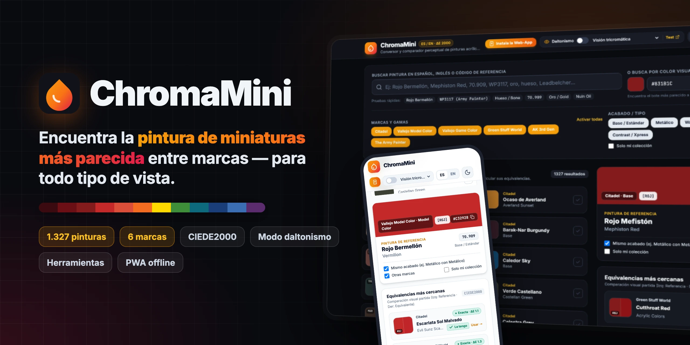
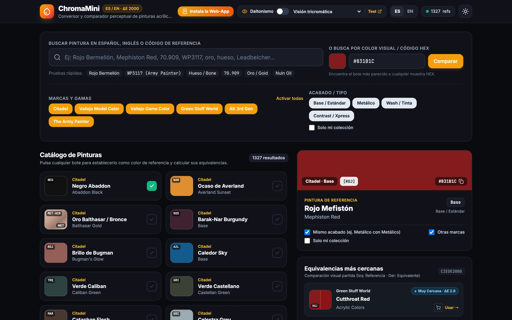
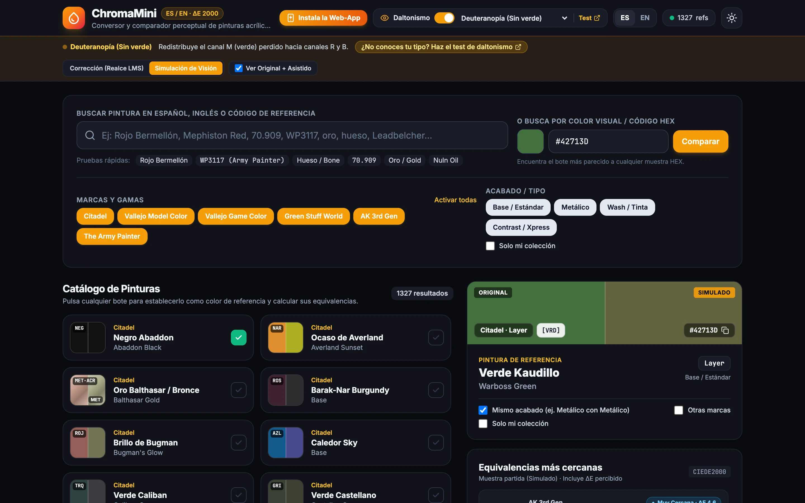
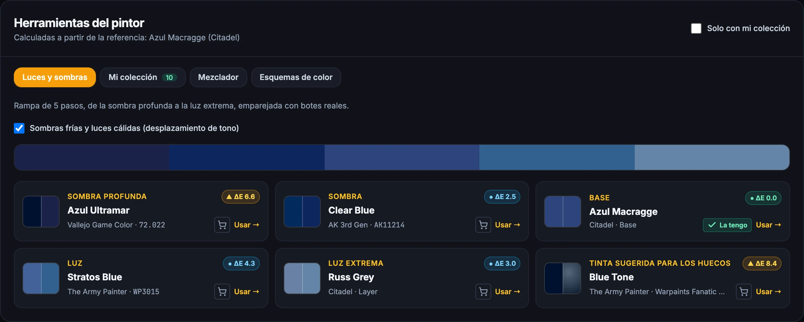
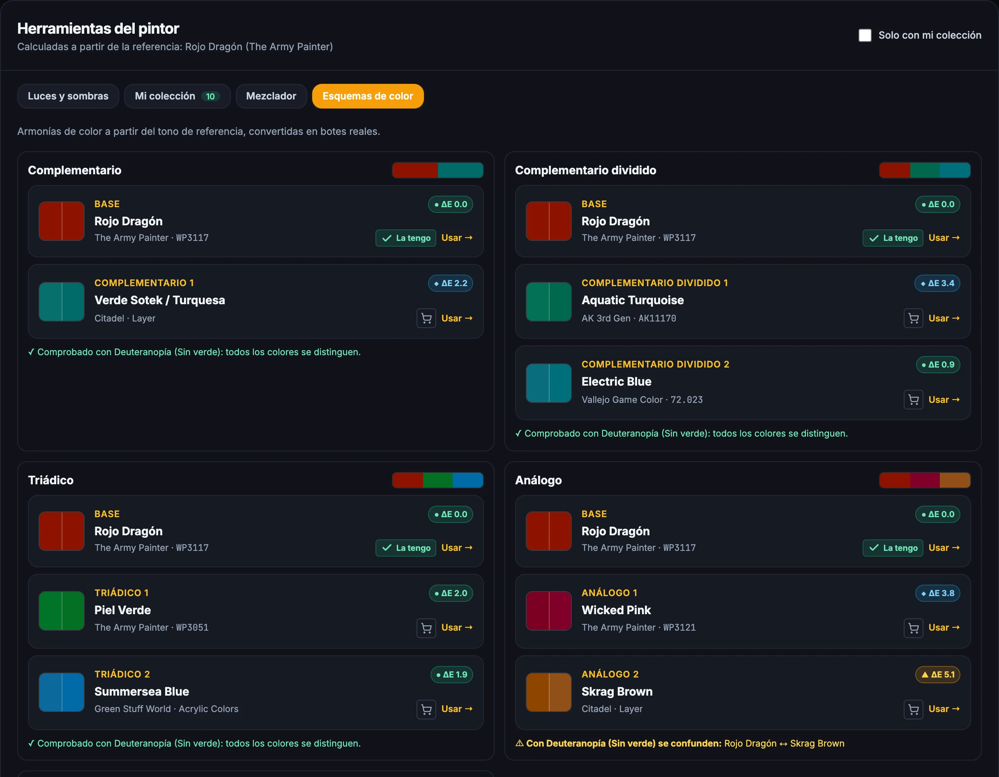
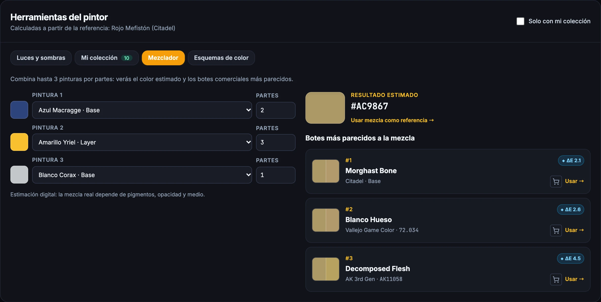
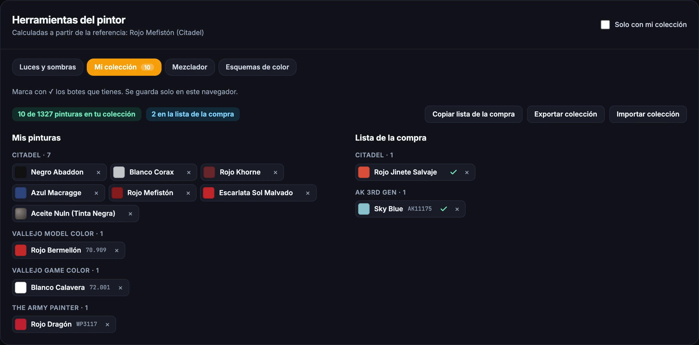
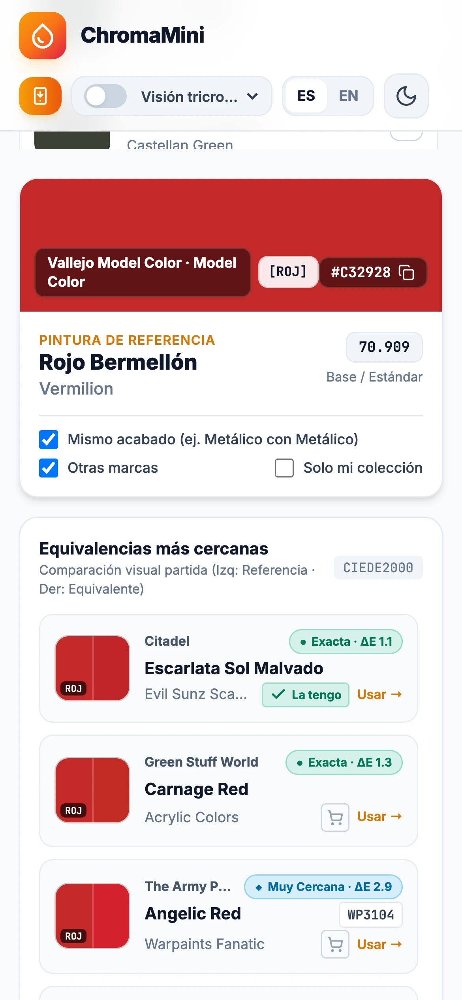
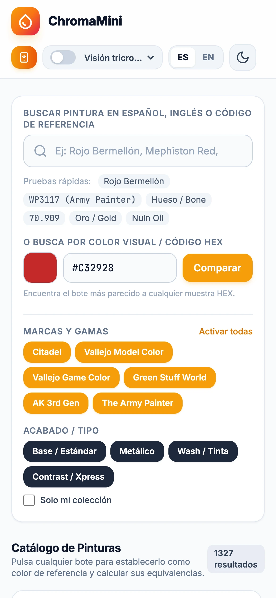

<div align="center">

<a href="https://firezenk.github.io/chromamini/"></a>

<h3>Encuentra la pintura de miniaturas más parecida entre marcas — para todo tipo de vista.</h3>

<p>
  <a href="https://firezenk.github.io/chromamini/"></a>
  
  
  <a href="LICENSE"></a>
</p>

<p>
  <b><a href="https://firezenk.github.io/chromamini/">Abrir la app</a></b> ·
  <a href="README.md">Read in English</a> ·
  <a href="#-funciones">Funciones</a> ·
  <a href="#-cómo-funciona">Cómo funciona</a> ·
  <a href="#-colaborar">Colaborar</a>
</p>

</div>

---

El tutorial pide *Mephiston Red* y tú solo tienes Vallejo. Tu azul favorito está agotado. Te cuesta distinguir
algunos rojos de algunos verdes. **ChromaMini** responde "¿cuál es el bote más parecido?" con un clic, usando la misma
ciencia del color que la industria gráfica, y de paso te planifica luces, mezclas y esquemas de color.

Sin cuentas, sin anuncios y sin instalar nada. Funciona en el navegador, también sin conexión, y en **español e
inglés**.

<div align="center">
  
</div>

## ✨ Funciones

### 🎯 Equivalencias entre marcas
Elige entre **1.327 pinturas** de **Citadel, Vallejo (Model, Game y Xpress), Green Stuff World, AK 3rd Gen y The
Army Painter**, o escribe cualquier color HEX. Las equivalencias se ordenan con **CIEDE2000 (ΔE00)**, la fórmula de
diferencia de color perceptual, y se etiquetan como *Exacta*, *Muy cercana*, *Aproximada* o *Alternativa*. Filtra por
marca, por acabado (base, metálico, tinta, contrast) o por las pinturas que tienes.

### 👁️ Pensada para pintores daltónicos
Ocho perfiles de visión (protán, deután y tritán en sus formas completa y parcial, más acromatopsia y acromatomalía):

- **Simulación**: muestra cómo se ven las muestras con ese tipo de daltonismo.
- **Corrección** (daltonización LMS): desplaza los colores para que las diferencias ocultas se vean.
- **Muestras partidas**: el color original y el asistido, uno al lado del otro.
- **Etiquetas de familia** (`ROJ`, `VRD`, `AZL`…) en cada bote, para no depender solo del color.
- **ΔE percibido**: avisa cuando dos pinturas distintas te parecerían iguales.

<div align="center">
  
</div>

### 🧰 Herramientas del pintor
Todo se calcula a partir de tu pintura de referencia:

| | |
|---|---|
| **Luces y sombras**<br>Rampa de 5 pasos, de la sombra profunda a la luz extrema, emparejada con botes reales. El desplazamiento de tono opcional da sombras frías y luces cálidas, y sugiere una tinta para los huecos. |  |
| **Esquemas de color**<br>Complementario, complementario dividido, triádico, análogo y tetrádico, convertidos en pinturas que puedes comprar. Con el modo daltonismo activo, señala los pares que no podrías distinguir. |  |
| **Mezclador**<br>Combina hasta 3 pinturas por partes y obtén el resultado estimado y los botes comerciales más parecidos. Responde a "no la tengo, ¿puedo mezclarla?". |  |
| **Mi colección**<br>Marca los botes que tienes y lleva una lista de la compra. Todas las herramientas pueden limitarse a "solo lo que tengo". Exporta e importa tu colección entre dispositivos. |  |

### 📱 En cualquier sitio, incluso sin conexión
Es una **PWA** instalable: añádela a la pantalla de inicio y úsala en la mesa de pintura sin Wi-Fi, en modo claro u
oscuro. El idioma, el tema, los filtros y tu colección se guardan en tu dispositivo. No se envía nada a ningún sitio.

<div align="center">
  
  &nbsp;&nbsp;
  
</div>

## 🔬 Cómo funciona

| Paso | Qué ocurre |
|---|---|
| **Espacio de color** | sRGB → RGB lineal → CIE XYZ (D65) → **CIELAB** |
| **Diferencia** | **CIEDE2000**, validada con los datos de prueba de Sharma, Wu y Dalal (2005) |
| **Daltonismo** | Simulación en el espacio de conos LMS (matrices tipo Viénot/Brettel) y daltonización por redistribución del error |
| **Rampas y esquemas** | Luminosidad y tono se manipulan en **CIE LCh**, con ajuste a la gama sRGB |
| **Mezclas** | Aproximación que combina mezcla aditiva y sustractiva (geométrica) en RGB lineal |

> [!NOTE]
> Los HEX son aproximaciones muestreadas de las cartas de color de cada marca. El bote real depende también de la
> imprimación, las capas, el barniz y tu pantalla. ChromaMini es una guía, no una medición de laboratorio.

## 🎨 Datos de pinturas

La base de datos viene de **[Paint Commons](https://github.com/paintcommons/catalog)**, un catálogo abierto y
mantenido por la comunidad en el que cada color indica su fuente (CC0, con los registros MIT acreditados en
[`THIRD_PARTY_NOTICES.md`](THIRD_PARTY_NOTICES.md)). Se genera con un script reproducible:

```bash
git clone https://github.com/paintcommons/catalog /tmp/paintcommons
node scripts/import-paintcommons.mjs /tmp/paintcommons
```

¿Has visto un color mal? Envía la corrección [a Paint Commons](https://paintcommons.org/catalogue/) para que llegue a
todos los proyectos y vuelve a ejecutar la importación.

## 🛠️ Desarrollo

Sin compilación y sin dependencias: HTML, Tailwind (CDN) y JavaScript.

```bash
git clone https://github.com/FireZenk/chromamini.git
cd chromamini
python3 -m http.server 8000   # y abre http://localhost:8000
```

`paints.json` se carga con `fetch`, así que sirve la carpeta por HTTP en lugar de abrir `index.html` directamente.

| Ruta | Para qué sirve |
|---|---|
| `index.html` | Toda la app: interfaz, ciencia del color, traducciones y herramientas |
| `paints.json` | Base de datos generada (`id, brand, range, name_es, name_en, code, type, hex, source`) |
| `scripts/import-paintcommons.mjs` | Regenera `paints.json` desde Paint Commons |
| `sw.js`, `manifest.webmanifest`, `icons/` | PWA: caché offline, manifiesto e iconos (sube `CACHE_VERSION` al cambiar archivos cacheados) |
| `docs/assets/` | Imágenes del README y vista previa para redes |

## 🤝 Colaborar

Toda ayuda es bienvenida:

- 🐛 **Errores e ideas:** [abre un issue](https://github.com/FireZenk/chromamini/issues).
- 🌍 **Traducciones:** todos los textos están en `UI_STRINGS` y `TOOL_STRINGS` dentro de `index.html`. Añadir un
  idioma consiste sobre todo en copiar el bloque `en`.
- 🎨 **Nombres en español:** la mayoría de nombres comerciales solo existen en inglés. Traducir el `name_es` de tu
  gama favorita es un gran primer PR.
- ♿ **Accesibilidad:** la opinión de pintores daltónicos vale oro. Cuéntanos qué funciona y qué no.

Si ChromaMini te ha ahorrado un viaje a la tienda, una ⭐ ayuda a que otros pintores la encuentren.

## 📜 Licencia

[MIT](LICENSE) © 2026 Jorge Garrido ([@FireZenk](https://github.com/FireZenk)).
Datos de pinturas: Paint Commons (CC0) y miniature-paints © Rick Fleuren (MIT); ver
[`THIRD_PARTY_NOTICES.md`](THIRD_PARTY_NOTICES.md).
Los nombres de pinturas y marcas son marcas registradas de sus propietarios. ChromaMini no está afiliada ni respaldada
por ningún fabricante de pinturas.
