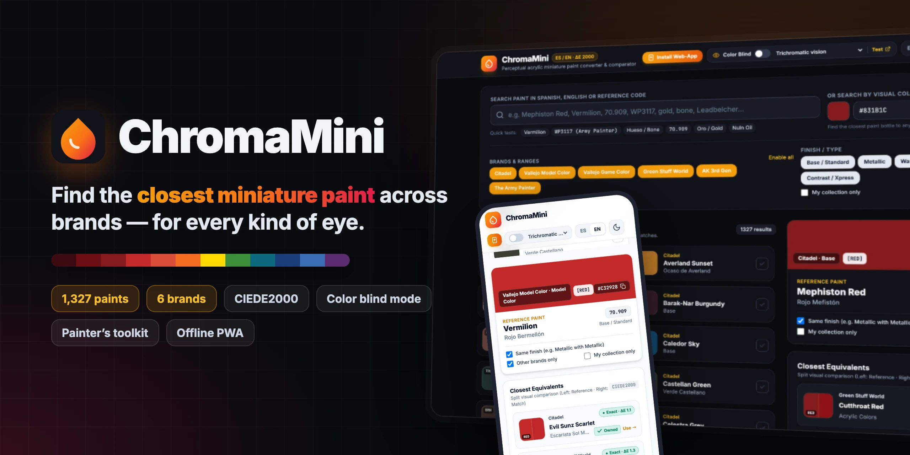
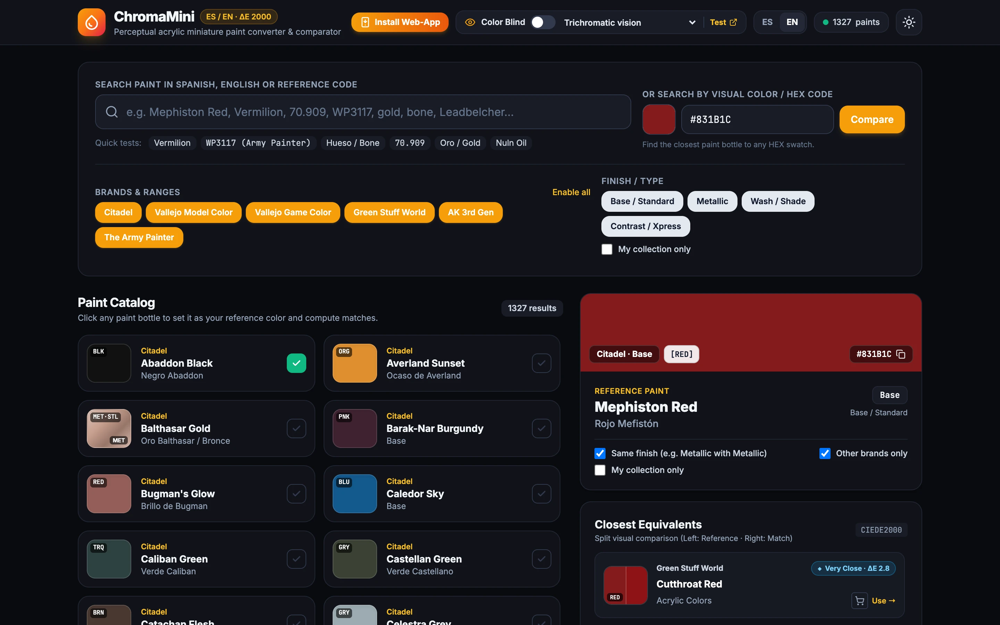
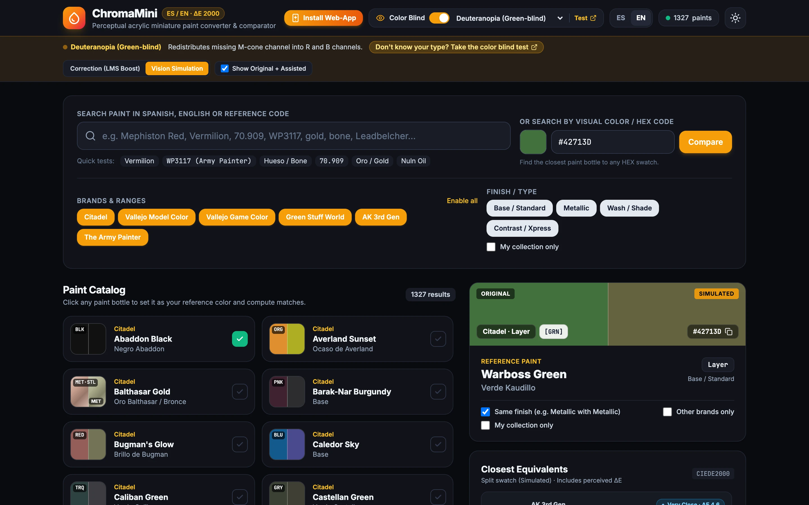
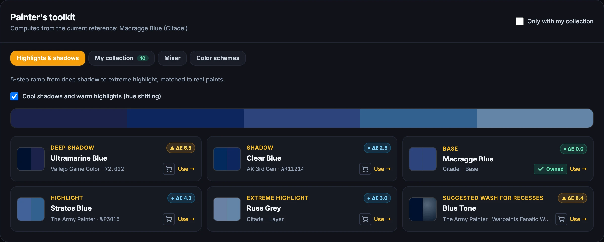
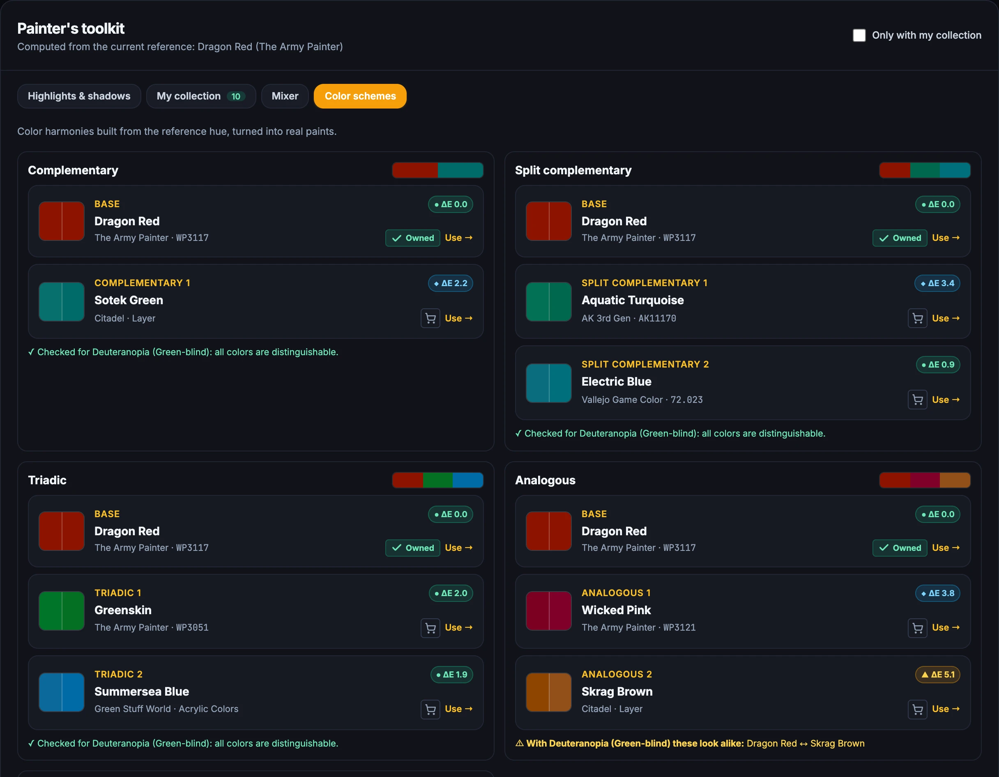
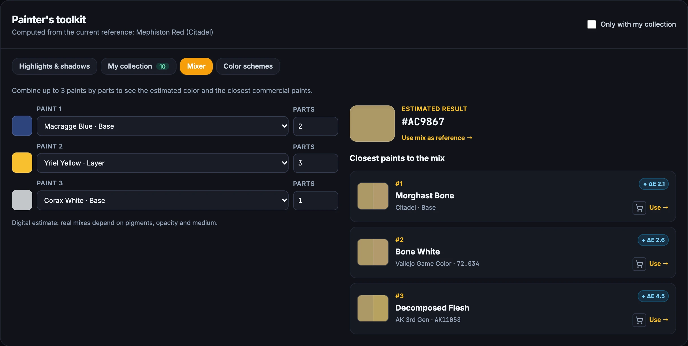
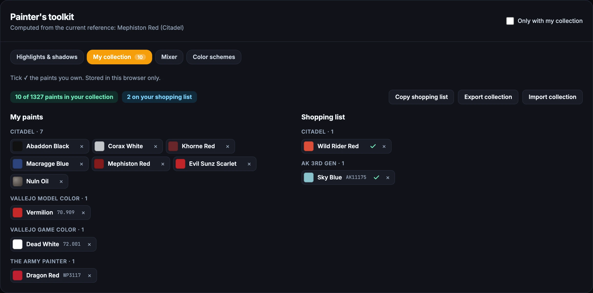
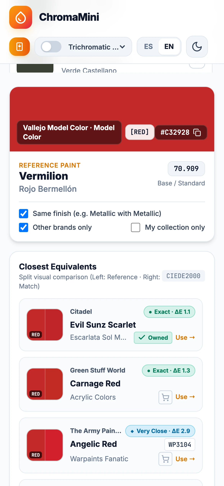
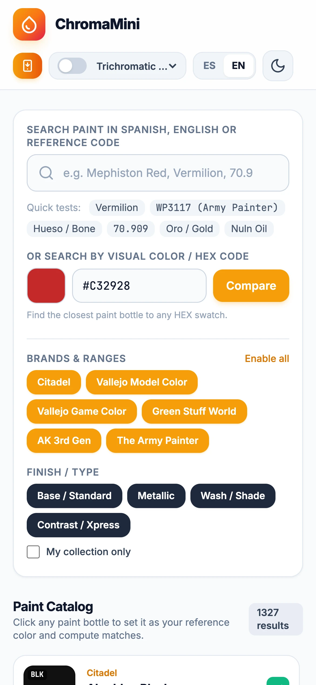

<div align="center">

<a href="https://firezenk.github.io/chromamini/"></a>

<h3>Find the closest miniature paint across brands — for every kind of eye.</h3>

<p>
  <a href="https://firezenk.github.io/chromamini/"></a>
  
  
  <a href="LICENSE"></a>
</p>

<p>
  <b><a href="https://firezenk.github.io/chromamini/">Open the app</a></b> ·
  <a href="README.es.md">Leer en español</a> ·
  <a href="#-features">Features</a> ·
  <a href="#-how-it-works">How it works</a> ·
  <a href="#-contributing">Contributing</a>
</p>

</div>

---

Your tutorial calls for *Mephiston Red* but you only own Vallejo. Your favourite blue is out of stock. You can't tell
some reds from some greens. **ChromaMini** answers "what's the closest bottle?" in one click, using the same colour
science the print industry uses, and it plans your highlights, mixes and colour schemes on the way.

No account, no ads, no install required. It runs in your browser, works offline, and speaks **English and Spanish**.

<div align="center">
  
</div>

## ✨ Features

### 🎯 Cross-brand paint matching
Pick any of **1,327 paints** from **Citadel, Vallejo (Model, Game & Xpress), Green Stuff World, AK 3rd Gen and The
Army Painter**, or type any HEX colour. Matches are ranked with **CIEDE2000 (ΔE00)**, the perceptual colour-difference
formula, and labelled *Exact*, *Very close*, *Approximate* or *Alternative*. Filter by brand, by finish (base,
metallic, wash, contrast) or by the paints you own.

### 👁️ Built for colour blind painters
Eight vision profiles (protan, deutan and tritan in both full and partial forms, plus achromatopsia and achromatomaly):

- **Simulation** shows how swatches look with that type of colour blindness.
- **Correction** (LMS daltonization) shifts colours so hidden differences become visible.
- **Split swatches** show the original and the assisted colour side by side.
- **Family tags** (`RED`, `GRN`, `BLU`…) on every bottle, so you never rely on colour alone.
- **Perceived ΔE** warns when two paints that really differ would look the same to you.

<div align="center">
  
</div>

### 🧰 Painter's toolkit
Everything is computed from your current reference paint:

| | |
|---|---|
| **Highlights & shadows**<br>A 5-step ramp from deep shadow to extreme highlight, matched to real bottles. Optional hue shifting gives cool shadows and warm highlights, and the tool suggests a wash for the recesses. |  |
| **Color schemes**<br>Complementary, split complementary, triadic, analogous and tetradic schemes, converted to paints you can buy. With colour blind mode on, it flags any pair you couldn't tell apart. |  |
| **Mixer**<br>Combine up to 3 paints by parts to get an estimated result and the commercial bottles closest to it. "I don't have it, can I mix it?" answered. |  |
| **My collection**<br>Tick the bottles you own and keep a shopping list. Every tool can be restricted to "only what I have". Export and import your collection between devices. |  |

### 📱 Everywhere, even offline
An installable **PWA**: add it to your home screen, use it at the painting desk without Wi-Fi, in light or dark mode.
Your language, theme, filters and collection are remembered on your device. Nothing is sent anywhere.

<div align="center">
  
  &nbsp;&nbsp;
  
</div>

## 🔬 How it works

| Step | What happens |
|---|---|
| **Colour space** | sRGB → linear RGB → CIE XYZ (D65) → **CIELAB** |
| **Difference** | **CIEDE2000**, validated against the Sharma–Wu–Dalal (2005) test data |
| **Colour blindness** | LMS cone-space simulation (Viénot/Brettel-style matrices) and error-redistribution daltonization |
| **Ramps & schemes** | Lightness and hue are manipulated in **CIE LCh**, with gamut mapping back to sRGB |
| **Mixing** | Approximation that blends additive and subtractive (geometric) mixing in linear RGB |

> [!NOTE]
> HEX values are approximations sampled from manufacturers' charts. A real pot also depends on primer, layering,
> varnish and your screen. ChromaMini is a guide, not a lab measurement.

## 🎨 Paint data

The paint database comes from **[Paint Commons](https://github.com/paintcommons/catalog)**, an open,
community-maintained catalogue where every colour names its source (CC0, with MIT-licensed records credited in
[`THIRD_PARTY_NOTICES.md`](THIRD_PARTY_NOTICES.md)). It is generated by a reproducible script:

```bash
git clone https://github.com/paintcommons/catalog /tmp/paintcommons
node scripts/import-paintcommons.mjs /tmp/paintcommons
```

Spotted a wrong colour? Send the fix [upstream to Paint Commons](https://paintcommons.org/catalogue/) so every
project benefits, then re-run the import.

## 🛠️ Development

Zero build step and zero dependencies: plain HTML, Tailwind (CDN) and vanilla JavaScript.

```bash
git clone https://github.com/FireZenk/chromamini.git
cd chromamini
python3 -m http.server 8000   # then open http://localhost:8000
```

`paints.json` is loaded with `fetch`, so serve the folder over HTTP instead of opening `index.html` directly.

| Path | Purpose |
|---|---|
| `index.html` | The whole app: UI, colour science, i18n, tools |
| `paints.json` | Generated paint database (`id, brand, range, name_es, name_en, code, type, hex, source`) |
| `scripts/import-paintcommons.mjs` | Rebuilds `paints.json` from Paint Commons |
| `sw.js`, `manifest.webmanifest`, `icons/` | PWA: offline cache, manifest, icons (bump `CACHE_VERSION` when cached files change) |
| `docs/assets/` | README images and social preview |

## 🤝 Contributing

Contributions are very welcome:

- 🐛 **Bugs and ideas:** [open an issue](https://github.com/FireZenk/chromamini/issues).
- 🌍 **Translations:** all UI text lives in `UI_STRINGS` and `TOOL_STRINGS` inside `index.html`. Adding a language
  is mostly copying the `en` block.
- 🎨 **Paint names in Spanish:** most commercial names only exist in English. A Spanish `name_es` for your favourite
  range is a great first PR.
- ♿ **Accessibility:** feedback from colour blind painters is gold. Tell us what works and what doesn't.

If ChromaMini saved you a trip to the store, a ⭐ helps other painters find it.

## 📜 License

[MIT](LICENSE) © 2026 Jorge Garrido ([@FireZenk](https://github.com/FireZenk)).
Paint data: Paint Commons (CC0) and miniature-paints © Rick Fleuren (MIT); see
[`THIRD_PARTY_NOTICES.md`](THIRD_PARTY_NOTICES.md).
Paint and brand names are trademarks of their respective owners. ChromaMini is not affiliated with or endorsed by any
paint manufacturer.
